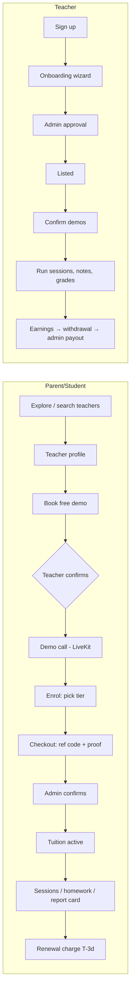
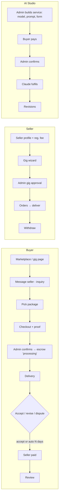
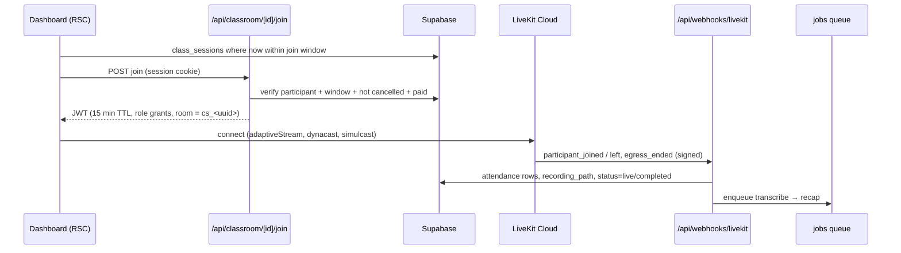

# Hayesh — Launch Blueprint (v2 architecture & upgrade plan)

**Date:** 26 Oct 2026 · **Baseline:** `main` @ `5e6fb44` (PR #1 merged) · **Companion docs:** `PROJECT-STATUS.md`, `PRODUCTION.md`, `ROADMAP.md`

This is an audit of the code as it exists today, not a generic checklist. Every
gap below was found in this repository; every fix names the table, route or
file it touches. Status legend: ✅ already done · ⚠️ partial · ❌ missing.

**Stack (fixed):** Next.js 15 App Router (TS strict) · Supabase (Postgres/RLS/Realtime/Storage) · LiveKit · Claude API · manual payment rail (+ Stripe dormant, Simpaisa planned) · Vercel.

---

## Owner decisions (26 Oct 2026) and how they change the plan

| Decision | Consequence |
|---|---|
| AI Studio stays **admin-only** | No third-party AI sellers; Phase 3 AI work targets matching, recaps, disputes |
| **Vercel Hobby + Supabase Free** until users arrive | Crons via Supabase `pg_cron` (migration 029) instead of Vercel (daily-only); weekly encrypted `pg_dump` via GitHub Actions instead of PITR; recordings go to **Cloudflare R2** (10 GB free) not Supabase Storage (1 GB). ⚠️ Vercel Hobby is non-commercial — move to Pro before real payments |
| Classes = **whatever the teacher's timetable says** (no cap) | Sprint 2: weekly timetable rules → `class_sessions` generated per billing period; exclusion constraint prevents overlaps |
| Recording retention **30 and 90 days** | Admin default + per-teacher override (`recording_retention_days` ∈ {30, 90}); a daily job deletes expired files from R2 |
| **Manual payments now, automatic later** | ✅ Done in Sprint 1: provider registry (manual always on; Stripe/Simpaisa switch on by env), idempotent webhooks — see `PAYMENTS-AUTOMATION.md` |

**Sprint 1 status: ✅ shipped** — distributed rate limiting (Upstash, fallback in-memory), Sentry (inert without DSN), report-only CSP, append-only admin audit log, admin TOTP two-factor (middleware + RLS), payment provider registry + webhook dedupe, performance indexes, pg_cron scheduler, encrypted weekly backups.

---

## Executive summary — the 10 changes that matter most

| # | Change | Why | Effort |
|---|---|---|---|
| 1 | **`class_sessions` + slot booking with a Postgres exclusion constraint** | Double booking is possible today — availability is free-form JSON, `demo_bookings`/`sessions`/`meetings` are three unrelated tables with no overlap guard | 2 sessions |
| 2 | **Join window + auto-start classroom from dashboard** | Today the teacher creates a meeting by hand; the booking and the room are not linked | 1 session |
| 3 | **LiveKit webhook → automatic attendance + recording URLs** | No `/api/webhooks/livekit` exists; attendance is manual and Egress output is never written back | 1 session |
| 4 | **Group classes** | `meetings` is 1:1 (`organizer_id` + single `participant_id`) but subscriptions sell a `group` tier | 1 session |
| 5 | **Job queue (`jobs` table + worker)** | AI fulfilment runs *inside* the admin's "Confirm payment" request (`lib/payments/settle.ts:227`, 60 s `maxDuration`) — a slow Claude call fails the admin action | 1 session |
| 6 | **Double-entry ledger + daily reconciliation** | Balances are derived from `transactions.status`; there is no independent proof money adds up | 2 sessions |
| 7 | **Gig milestones + custom offers** | Only fixed packages exist; large jobs (and Upwork-style work) need staged escrow | 2 sessions |
| 8 | **Off-platform contact detection in messages** | #1 revenue leak for PK marketplaces (WhatsApp numbers in chat) | 0.5 session |
| 9 | **Distributed rate limiting + Sentry** | `lib/security/rate-limit.ts` is an in-memory `Map` — per serverless instance, i.e. not a limit | 0.5 session |
| 10 | **Whiteboard + noise suppression + virtual background + audio-only mode** | The classroom differentiators | 2 sessions |

---

## PHASE 1 — Workflow & gap analysis

### 1.1 Journey maps (as built)





### 1.2 Gaps & friction (found in code)

| Area | Gap | Evidence | Fix |
|---|---|---|---|
| Scheduling | No slot model; availability is a JSON grid on the teacher | `components/teacher/AvailabilityGrid.tsx`, `teachers.availability` | `teacher_availability_rules` + generated slots, exclusion constraint (Phase 5 #1) |
| Scheduling | Three disconnected tables: `demo_bookings.livekit_room`, `sessions.livekit_room`, `meetings` | `supabase-schema.sql:141,198`, migration 011 | Unify into `class_sessions` (Phase 2.4) |
| Scheduling | Tuition doesn't generate its lessons — `subscriptions.sessions_per_week` is never expanded into sessions | `supabase-schema.sql:187` | Recurring rule → sessions generated by the cron per billing period |
| Scheduling | No reschedule / cancellation / no-show policy | — | `cancel_policy` in settings; late cancel = lesson consumed; teacher no-show = credit |
| Time zones | International parents see PK times | no `profiles.timezone` | Store UTC (already), add `profiles.timezone`, render with `Intl.DateTimeFormat` |
| Classroom | 1:1 only; `group` tier is sold but can't be delivered | `meetings.participant_id` | `class_session_participants` join table |
| Classroom | Attendance is teacher-entered | no LiveKit webhook | Webhook-derived attendance (Phase 2.5) |
| Classroom | Recording: Egress code exists but output never persisted | `lib/livekit/egress.ts`, no webhook | `egress_ended` → `class_sessions.recording_path` |
| Marketplace | No milestones, no custom offers, no "buyer requirements" step after payment | `gig_orders` has one `requirements` text | Phase 3.4 |
| Marketplace | Seller response time / on-time rate not computed | — | Nightly materialised stats → shown on gig card (trust signal) |
| Marketplace | Off-platform contact leakage | `messages` unfiltered | Phase 3.2 |
| AI Studio | Fulfilment inline in payment confirmation | `settle.ts:227` | Job queue (Phase 4.3) |
| AI Studio | Your brief says "users buying/selling AI prompts" — Hayesh's AI Studio is **admin-curated only** | `ai_services` admin-owned | Keep it that way for launch. Third-party prompt sellers bring IP theft, prompt-leak and moderation cost; add later as a seller *category* with output-only delivery |
| Payments | Manual confirmation is the bottleneck at scale | Admin → Payments | SLA dashboard (oldest pending age) now; Simpaisa later |
| Admin | No audit log of admin actions on money | — | `admin_audit_log` (Phase 6) |
| Trust | Seller/teacher identity verification is document upload only | migration 009 | CNIC + selfie check by admin, "ID verified" badge |

### 1.3 Delighter features (what Fiverr/Upwork clones don't have)

1. **Auto lesson recap for parents.** The recording is transcribed, Claude drafts "what was covered, homework, one thing to practise" and the teacher approves it in one click. The recap feeds the monthly report card that already exists. This is the single strongest retention feature for the parent persona.
2. **Live attendance and punctuality score.** Computed from LiveKit join timestamps and shown on teacher cards: "Joins on time 98%".
3. **Request-a-tutor in plain language.** The parent writes "O-level physics, weak in mechanics, evenings, under ₨15k". Claude extracts filters, hybrid search runs, and the parent gets 3 ranked matches with reasons (Phase 3.1).
4. **Escrow progress bar on every order.** Shows Paid → In progress → Delivered → Released, with the auto-release countdown. It makes "You pay Hayesh, not the seller" visible.
5. **Blind double-sided reviews.** Neither side sees the other's review until both submit or 14 days pass. This kills retaliation reviews.
6. **Urdu/English everywhere.** UI i18n and (Phase 6 roadmap) live translated audio. No competitor in PK has this.
7. **Demo-to-enrol in one tap.** At the end of the demo call the parent sees "Enrol with this teacher" inside the room. Checkout is pre-filled and the reference code is shown.
8. **Homework photo → AI hint (not answer).** The student uploads a photo and gets Socratic hints. Teacher-visible, never a full solution.

---

## PHASE 2 — Conferencing & classroom upgrade

### 2.1 Stack decision: **stay on LiveKit** (move to LiveKit Cloud)

| | LiveKit (current) | Agora | Daily.co | Raw WebRTC/mesh |
|---|---|---|---|---|
| Already integrated | ✅ tokens, egress, moderation, waiting room, data channel | ❌ rewrite | ❌ rewrite | ❌ |
| Open source / self-host escape hatch | ✅ | ❌ | ❌ | ✅ |
| Recording | Egress (room composite / track) | Cloud recording | ✅ | build it |
| AI agents (translation, transcription) | **LiveKit Agents** — matches the Deepgram→Claude→ElevenLabs plan | 3rd party | 3rd party | ❌ |
| Noise cancellation | Krisp-based filter on LiveKit Cloud | ✅ | ✅ | browser only |
| Group > 4 people | SFU ✅ | ✅ | ✅ | ❌ mesh collapses |

Migrating would cost weeks and buy nothing. Use **LiveKit Cloud**. Pick the region nearest Pakistan (check the current region list for the Middle East and South Asia). Keep self-hosting as a cost lever once you pass roughly 10k participant-hours a month.

### 2.2 Target architecture



### 2.3 Feature implementation

| Feature | Status | Implementation |
|---|---|---|
| Screen share | ✅ (`ControlDock.tsx`, request-to-present) | Add `setScreenShareEnabled(true, { audio: true, contentHint: 'detail' })` and publish at 1080p/15fps with `screenShareEncoding` for legible text |
| Interactive whiteboard | ❌ | **Excalidraw** (MIT; avoid tldraw's production licence cost). Sync over the LiveKit reliable data channel on topic `wb`, sending element *deltas*: reliable packets should stay small (~15 KB), so batch every 50 ms and chunk. The teacher is authoritative. Snapshot the scene to Storage (`classroom/<session>/board.json`) every 30 s and on end; late joiners load the snapshot. Lazy-load with `next/dynamic` (Excalidraw is about 1 MB) |
| Recording | ⚠️ Egress code, no storage, no write-back | Egress → S3-compatible bucket (Supabase Storage's S3 endpoint or Cloudflare R2). `egress_ended` webhook stores the path. Signed URL on view (1 h). Show a visible "Recording" pill and a consent notice on join (needed for minors) |
| Audio-only fallback | ⚠️ `adaptiveStream`/`dynacast` on | Listen to `ConnectionQualityChanged`. On `Poor` for more than 10 s, prompt "Switch to audio-only", then `setCameraEnabled(false)` and unsubscribe remote video (`publication.setSubscribed(false)`). Add a manual "Data saver" toggle and remember it per user |
| Noise cancellation | ❌ | Tier 1 (free): `audioCaptureDefaults: { noiseSuppression: true, echoCancellation: true, autoGainControl: true }`. Tier 2: `@livekit/krisp-noise-filter` (LiveKit Cloud), toggle in PreJoin |
| Virtual background / blur | ❌ | `@livekit/track-processors` (`BackgroundBlur(10)`, `VirtualBackground(url)`). Offer it only when `supportsBackgroundProcessors()` is true, and disable it automatically on low-end Android (CPU) |
| Group classes | ❌ | `class_session_participants` with roles; webinar mode gives students `canPublish:false` until the teacher grants the floor (moderation route exists) |
| Hand raise, polls, quick quiz | ⚠️ reactions only | Data channel topic `class` with `{type:'poll'}`; results persisted at end |
| Breakout rooms | later | Separate rooms `cs_<id>_b<n>`, teacher token with `roomAdmin` on all |
| Live translation | ❌ (roadmap Phase 6) | LiveKit Agent worker: Deepgram → Claude → ElevenLabs, only if `teachers.translation_enabled` |

Client connect options (`components/video/VideoRoom.tsx`):

```ts
const room = new Room({
  adaptiveStream: true,
  dynacast: true,
  publishDefaults: {
    simulcast: true,
    videoSimulcastLayers: [VideoPresets.h180, VideoPresets.h360],
    videoCodec: 'vp9',             // SVC; LiveKit falls back for Safari
    backupCodec: { codec: 'vp8' },
    red: true,                     // redundant audio — big win on lossy mobile data
    dtx: true,
  },
  audioCaptureDefaults: { noiseSuppression: true, echoCancellation: true, autoGainControl: true },
  reconnectPolicy: new DefaultReconnectPolicy(),
})
room.on(RoomEvent.Reconnecting, () => setBanner('Reconnecting…'))
     .on(RoomEvent.Reconnected,  () => setBanner(null))
     .on(RoomEvent.Disconnected, (reason) => reason !== DisconnectReason.CLIENT_INITIATED && offerRejoin())
```

### 2.4 Schema: unify bookings, lessons and meetings

```sql
-- migration 026-class-sessions.sql
create extension if not exists btree_gist;

create table public.class_sessions (
  id              uuid primary key default gen_random_uuid(),
  kind            text not null check (kind in ('demo','tuition','group','meeting')),
  teacher_id      uuid references public.teachers(id),
  host_id         uuid not null references public.profiles(id),
  subscription_id uuid references public.subscriptions(id),
  demo_booking_id uuid references public.demo_bookings(id),
  title           text not null,
  starts_at       timestamptz not null,
  ends_at         timestamptz not null check (ends_at > starts_at),
  status          text not null default 'scheduled'
                  check (status in ('scheduled','live','completed','cancelled','no_show_teacher','no_show_student')),
  room_name       text generated always as ('cs_' || id::text) stored,
  recording_path  text,
  whiteboard_path text,
  recap           jsonb,                 -- AI draft, teacher-approved
  recap_approved_at timestamptz,
  created_at      timestamptz default now(),
  -- a host can never be double-booked (cancelled rows don't count)
  constraint no_host_overlap exclude using gist (
    host_id with =, tstzrange(starts_at, ends_at, '[)') with &&
  ) where (status not in ('cancelled'))
);

create table public.class_session_participants (
  session_id uuid references public.class_sessions(id) on delete cascade,
  profile_id uuid references public.profiles(id) on delete cascade,
  role       text not null default 'student' check (role in ('host','cohost','student','observer')),
  primary key (session_id, profile_id)
);

create table public.class_attendance (
  id          bigint generated always as identity primary key,
  session_id  uuid not null references public.class_sessions(id) on delete cascade,
  profile_id  uuid not null references public.profiles(id),
  joined_at   timestamptz not null,
  left_at     timestamptz,
  lk_event_id text unique                -- webhook idempotency
);

create index on public.class_sessions (host_id, starts_at);
create index on public.class_session_participants (profile_id);
create index on public.class_attendance (session_id, profile_id);
```

Migration path: backfill from `demo_bookings`, `sessions` and `meetings`, then make those tables write to `class_sessions` (or views over it). Keep the old columns read-only for one release.

### 2.5 Auto-start from the dashboard

* **Join window:** `starts_at - 10 min` → `ends_at + 15 min`. The dashboard "Join class" button appears via a Supabase Realtime subscription on `class_sessions` (or a 30 s client tick). No manual meeting creation.
* **Token endpoint** (replaces ad-hoc use of `/api/livekit/token` for classes):

```ts
// app/api/classroom/[id]/join/route.ts
const JOIN_EARLY_MS = 10 * 60_000
const JOIN_LATE_MS = 15 * 60_000

export async function POST(_req: Request, { params }: { params: Promise<{ id: string }> }) {
  const { id } = await params
  const user = await requireUser()                       // lib/auth/require-user.ts
  const admin = createAdminClient()
  const { data: cs } = await admin.from('class_sessions')
    .select('id, room_name, status, starts_at, ends_at, host_id, class_session_participants(profile_id, role)')
    .eq('id', id).single()
  if (!cs) return NextResponse.json({ error: 'Not found' }, { status: 404 })

  const me = cs.host_id === user.id ? 'host'
    : cs.class_session_participants.find((p) => p.profile_id === user.id)?.role
  if (!me) return NextResponse.json({ error: 'Not found' }, { status: 404 })   // don't leak existence
  if (cs.status === 'cancelled') return NextResponse.json({ error: 'Class cancelled' }, { status: 409 })

  const now = Date.now()
  if (now < Date.parse(cs.starts_at) - JOIN_EARLY_MS || now > Date.parse(cs.ends_at) + JOIN_LATE_MS)
    return NextResponse.json({ error: 'Outside the join window' }, { status: 403 })

  const token = await createLiveKitToken({
    room: cs.room_name, identity: user.id, ttlSeconds: 15 * 60,  // join-only; LiveKit refreshes in-session
    canPublish: me !== 'observer', roomAdmin: me === 'host' || me === 'cohost',
    metadata: JSON.stringify({ role: me }),
  })
  return NextResponse.json({ token, url: process.env.NEXT_PUBLIC_LIVEKIT_URL })
}
```

* **LiveKit webhook** (new). Verify the signature with `WebhookReceiver` from `livekit-server-sdk`.
  * `room_started` → set `status='live'`.
  * `participant_joined` / `participant_left` → `class_attendance`, idempotent on `event.id`.
  * `room_finished` → set `completed`, then run a no-show rule: the host never joined → `no_show_teacher`, which credits the lesson back.
  * `egress_ended` → set `recording_path` and enqueue a `transcribe` job.
* **Reminders** run 24 h, 1 h and 10 min before a class through in-app, email and (later) WhatsApp. Vercel Hobby crons run **daily only**. Use Vercel Pro (every 5 min) or **Supabase `pg_cron` + `pg_net`** calling `/api/cron/reminders`.

---

## PHASE 3 — AI & marketplace

### 3.1 AI integration map

| Use case | Model | Design | Guardrail |
|---|---|---|---|
| **Skill matching / "request a tutor"** | Haiku 4.5 (extract) + embeddings | 1) Claude tool-call extracts `{subject, level, budget_pkr, days, times, language}`. 2) Hybrid search: SQL filters + `pgvector` cosine on `teachers.embedding`/`gigs.embedding` (embed profile text with **Voyage AI**, Anthropic's recommended embeddings partner). 3) Re-rank with Bayesian rating + punctuality. 4) Claude writes a 1-line "why this match" | Only public profile fields go in the prompt |
| **Off-platform contact detection** | regex → Haiku on hit | Phone/WhatsApp/email/"contact me outside" in `messages` before insert (server route already writes messages). Mask + warn the sender; 3 strikes → admin flag | Never block silently; show why |
| **Dispute assistant** | Sonnet | Admin opens dispute → job assembles requirements, package scope, delivery files list, message thread → Claude returns `{summary, timeline, scope_match: 0-1, suggested_outcome, confidence, cited_messages[]}` | **Advisory only.** Money moves only on an admin click; the suggestion is logged |
| **Lesson recap / AI TA** | Deepgram (STT) → Sonnet | `egress_ended` → transcribe → recap draft → teacher approves → parent notification + report card | Teacher approval required (minors) |
| **Seller delivery pre-check** | Haiku | Before "Deliver", compare delivery notes/files list to package deliverables; warn "Package promised 3 revisions + source file — no source file attached" | Seller can override |
| **Gig/teacher listing quality** | Haiku | On submit for approval: score title/description/pricing, flag policy violations → speeds admin approval queue | Admin decides |
| **Homework hint bot** | Sonnet | Socratic system prompt, image input, refuses full solutions, logs to teacher | Rate-limited per child |
| **AI Studio** | per service | ✅ exists (confidentiality guard, revisions) → move to job queue | ✅ prompt never exposed |

Pattern for every AI feature: **enqueue a job, never run inline**. Store `{model, input_hash, output, tokens, cost}` in `ai_runs` for cost tracking and replays. Use structured output through tool calling (the JARVIS pattern in `lib/ai/jarvis-tools.ts`).

### 3.2 Off-platform detector (cheap first pass)

```ts
// lib/messages/contact-guard.ts
const PATTERNS: readonly RegExp[] = [
  /(?:\+?92|0)\s*3\d{2}[\s-]?\d{7}/,              // PK mobile
  /\b\d{4}[\s.-]?\d{7}\b/,                         // spaced numbers
  /[\w.+-]+@[\w-]+\.[\w.]+/,                       // email
  /\b(whats\s?app|wa\.me|telegram|t\.me|skype|insta(gram)?|direct(ly)? pay)\b/i,
]
export interface GuardResult { flagged: boolean; masked: string }
export function guardContact(text: string): GuardResult {
  let masked = text
  for (const re of PATTERNS) masked = masked.replace(new RegExp(re, 'gi'), '••••')
  return { flagged: masked !== text, masked }
}
```

### 3.3 Escrow made bulletproof — double-entry ledger

Today a balance is "sum of completed `transactions` with `payee_id`" plus the withdrawal trigger. That works, but nothing *proves* the books balance. Add an append-only ledger beside it and reconcile nightly.

```sql
-- migration 027-ledger.sql
create table public.ledger_accounts (
  id   text primary key,               -- 'platform:revenue', 'escrow', 'user:<uuid>:available', 'user:<uuid>:pending', 'cash:bank'
  kind text not null check (kind in ('asset','liability','revenue'))
);
create table public.ledger_entries (
  id             bigint generated always as identity primary key,
  journal_id     uuid not null,          -- groups the legs of one event
  account_id     text not null references public.ledger_accounts(id),
  amount_minor   bigint not null,        -- paisa/cents; +debit / -credit
  currency       char(3) not null,
  transaction_id uuid references public.transactions(id),
  reason         text not null,          -- 'payment_confirmed','escrow_release','commission','payout','refund'
  created_at     timestamptz not null default now(),
  unique (journal_id, account_id)
);
-- every journal must net to zero
create function public.assert_journal_balanced() returns trigger language plpgsql as $$
begin
  if (select sum(amount_minor) from public.ledger_entries where journal_id = new.journal_id) <> 0 then
    raise exception 'unbalanced journal %', new.journal_id;
  end if;
  return null;
end $$;
create constraint trigger ledger_balanced after insert on public.ledger_entries
  deferrable initially deferred for each row execute function public.assert_journal_balanced();
revoke update, delete on public.ledger_entries from anon, authenticated;
```

Postings are written in the same RPC as the existing settlement step (`markTransactionPaid`, release, refund, payout):

| Event | Debit | Credit |
|---|---|---|
| Payment confirmed (gig) | `cash:bank` | `escrow` |
| Escrow released | `escrow` | `user:seller:available` (net) + `platform:revenue` (commission) |
| Tuition confirmed | `cash:bank` | `user:teacher:available` (net) + `platform:revenue` |
| Refund | `escrow` | `cash:bank` |
| Payout approved | `user:x:available` | `cash:bank` |

**Nightly reconciliation job.** It checks:
* `escrow` balance equals the sum of `processing` gig orders;
* each user's `available` balance equals their withdrawable balance computed the old way;
* the `cash:bank` delta matches the confirmed manual payments.

Any mismatch raises an admin alert and blocks payouts.

Store money as **integer minor units** everywhere new. `amount_usd decimal(10,2)` is fine to read, but convert at the boundary.

### 3.4 Milestones & custom offers

```sql
create table public.gig_offers (            -- seller → buyer custom offer from an inquiry thread
  id uuid primary key default gen_random_uuid(),
  conversation_id uuid not null references public.conversations(id),
  seller_id uuid not null, buyer_id uuid not null, gig_id uuid references public.gigs(id),
  title text not null, description text not null,
  total_minor bigint not null check (total_minor > 0), currency char(3) not null,
  expires_at timestamptz not null,
  status text not null default 'sent' check (status in ('sent','accepted','declined','expired','withdrawn'))
);
create table public.order_milestones (
  id uuid primary key default gen_random_uuid(),
  gig_order_id uuid not null references public.gig_orders(id) on delete cascade,
  position smallint not null,
  title text not null,
  amount_minor bigint not null check (amount_minor > 0),
  due_at timestamptz,
  status text not null default 'pending'
    check (status in ('pending','funded','delivered','revision_requested','released','disputed','refunded')),
  transaction_id uuid references public.transactions(id),
  unique (gig_order_id, position)
);
```

Each milestone is funded through the existing checkout (`type: 'milestone'`). Delivering, revising, accepting and disputing reuse the current order state machine *per milestone*. The order completes when every milestone is `released` or `refunded`. Milestone amounts must sum to the offer total, enforced in the accept-offer RPC.

### 3.5 Ratings that can't be gamed

* ✅ Reviews only from verified customers (migration 021, 025).
* **Rank by Bayesian average, display raw.** This stops a single 5★ review outranking 200 reviews at 4.9★:

```sql
-- C = platform mean, m = confidence weight (e.g. 10)
create or replace view public.gig_rank as
select g.id,
  (g.total_reviews * coalesce(g.average_rating,0) + 10 * s.mean) / (g.total_reviews + 10) as bayes_rating
from public.gigs g cross join (select avg(average_rating) mean from public.gigs where total_reviews > 0) s;
```

* **Time decay.** Weight reviews from the last 12 months at 1.0 and older ones at 0.5.
* **One review per order.** Use a unique `(order_id)` and allow edits for 7 days only.
* **Blind double-sided reveal** (delighter #5).
* **Anomaly flags.** Raise a flag on:
  * more than 3 reviews from accounts created within 48 h of each other;
  * reviewer and seller sharing a payment account or IP;
  * a rating burst.

  Send flags to the existing admin moderation queue (`/admin/reviews`).

---

## PHASE 4 — Performance & UX

### 4.1 Frontend checklist

| ✔ | Item | Hayesh specifics |
|---|---|---|
| ☐ | Bundle audit | `@next/bundle-analyzer`. Biggest candidates: three.js / R3F (AuroraField), livekit-client, framer-motion, recharts, Excalidraw |
| ☐ | Lazy-load heavy client islands | `next/dynamic(() => import('…/AuroraField'), { ssr: false })` on the landing page only. Load `VideoRoom` only on `/meet/[id]`. Load charts only on dashboards |
| ☐ | Respect reduced motion and low-end devices | Freeze the shader when `prefers-reduced-motion` is set or `navigator.hardwareConcurrency <= 4` |
| ☑ | Route-level `loading.tsx` skeletons | Exists. Add skeletons to *inner* Suspense boundaries (reviews, "more from this seller") so the gig page streams |
| ☐ | Cache public catalogue pages | Teacher, gig and AI listing pages are rendered per request because the Supabase server client reads cookies. Fetch public data with a cookie-less anon client inside `unstable_cache(…, { tags: ['gigs'] })`, and call `revalidateTag('gigs')` on approve/edit. Anonymous traffic is then served from cache |
| ☐ | Images | Use `next/image` with explicit `sizes` and Supabase image transformations (`?width=480&quality=70`) for cards. Use AVIF/WebP |
| ☐ | Optimistic UI | Messages, mark-as-read, favourites and review replies via `useOptimistic` |
| ☐ | Client state | No global store is needed. Server data stays in RSC/route handlers; client islands use local state and Realtime. Add TanStack Query only for highly interactive admin tables (pagination, filters) |
| ☐ | Fonts | Already `next/font` Geist (no layout shift) ✅ |
| ☐ | Core Web Vitals budget | LCP < 2.5 s on 4G Moto G, INP < 200 ms, CLS < 0.1. Enforce with Lighthouse CI in GitHub Actions |
| ☐ | Prefetch | `<Link prefetch>` defaults are fine. Turn prefetch off on long admin tables |

### 4.2 Database checklist

1. **RLS performance (biggest single win on Supabase).** Rewrite policies as `using ((select auth.uid()) = user_id)` instead of `auth.uid() = user_id`. The sub-select is evaluated once rather than once per row. Index every column used in a policy predicate.
2. **Missing indexes** (only 40 `create index` across 25 migrations). Add these, then confirm with `explain analyze`:

```sql
create index concurrently if not exists gig_orders_buyer_status   on public.gig_orders (buyer_id, status, created_at desc);
create index concurrently if not exists gig_orders_seller_status  on public.gig_orders (seller_id, status, created_at desc);
create index concurrently if not exists tx_payee_status           on public.transactions (payee_id, status);
create index concurrently if not exists tx_pending_age            on public.transactions (created_at) where status = 'pending';
create index concurrently if not exists messages_conv_created     on public.messages (conversation_id, created_at desc);
create index concurrently if not exists notifications_user_unread on public.notifications (user_id, created_at desc) where read = false;
create index concurrently if not exists sessions_teacher_time     on public.sessions (teacher_id, scheduled_at);
create index concurrently if not exists gigs_active_category      on public.gigs (category, created_at desc) where status = 'active';
```

   Check the actual column names against `supabase-schema.sql` before running. Run in the SQL editor one statement at a time, because `concurrently` cannot run inside a transaction.
3. **Search.** Use a `tsvector` generated column with a GIN index on gig and teacher text instead of `ilike '%q%'`. Use `pg_trgm` for typo tolerance and `pgvector` for semantic matching (Phase 3.1).
4. **Pagination.** Use keyset pagination (`created_at < $cursor`) on messages, orders and admin tables. Never use `offset` past page 5.
5. **Observability.** Enable `pg_stat_statements` and review Supabase's Query Performance and Index Advisor weekly.
6. **Connection pooling.** Server routes use supabase-js over HTTP (PostgREST), which is fine. Any direct `pg` usage must go through the Supavisor pooler in transaction mode.

### 4.3 Background jobs (replace inline heavy work)

```sql
create table public.jobs (
  id bigint generated always as identity primary key,
  kind text not null,                    -- 'ai_fulfil','transcribe','recap','email','reconcile','embed'
  payload jsonb not null,
  dedupe_key text unique,                -- e.g. 'ai_fulfil:<order_id>'
  run_at timestamptz not null default now(),
  attempts int not null default 0,
  max_attempts int not null default 5,
  locked_until timestamptz,
  last_error text,
  status text not null default 'queued' check (status in ('queued','running','done','dead'))
);
create index on public.jobs (status, run_at) where status = 'queued';

create function public.claim_jobs(p_limit int) returns setof public.jobs
language sql security definer set search_path = public as $$
  update public.jobs j set status='running', attempts=attempts+1, locked_until=now()+interval '5 min'
  where j.id in (
    select id from public.jobs
    where (status='queued' and run_at <= now()) or (status='running' and locked_until < now())
    order by run_at limit p_limit for update skip locked)
  returning j.*;
$$;
revoke execute on function public.claim_jobs(int) from anon, authenticated;
```

* The worker is `/api/cron/jobs`, protected by `CRON_SECRET`. It calls `rpc('claim_jobs', {p_limit: 5})`, processes each job, then marks it `done`. On failure it sets `run_at = now() + 2^attempts min` and marks the job `dead` after `max_attempts`, which raises an admin alert.
* Trigger the worker from `pg_cron` every minute, and also fire-and-forget right after enqueueing for low latency.
* The first migration is `settle.ts:227`: enqueue `ai_fulfil` instead of awaiting Claude. The admin's confirm becomes instant, and a failed generation retries on its own.
* Alternative if you prefer managed: Inngest or Upstash QStash. Both work on Vercel. Postgres-native keeps one less vendor.

---

## PHASE 5 — Top 20 edge cases (with Hayesh status)

| # | Edge case | Hayesh today | Prevention pattern |
|---|---|---|---|
| 1 | **Double booking a teacher slot** (two parents, same second) | ❌ no guard | `exclude using gist` (Phase 2.4). Catch `23P01` → "That slot was just taken" |
| 2 | Admin confirms the same payment twice / two admins at once | ✅ conditional update `where status='pending'` | Keep. Every state transition is `update … where status = <expected> returning *` and 0 rows means a no-op |
| 3 | Stripe/Simpaisa webhook retried, out of order, or forged | ✅ signature + amount check, idempotent settle | Add a `webhook_events(provider, event_id primary key, received_at, payload)` insert-first dedupe for Simpaisa too |
| 4 | Webhook arrives before the checkout row commits | ⚠️ | Return 500 when the transaction is not found, so the provider retries; never 200 a miss |
| 5 | Concurrent withdrawals overdrawing a balance | ✅ `pg_advisory_xact_lock` in migration 007 | Keep. Mirror the check in ledger reconciliation |
| 6 | Escrow auto-release while a dispute is being opened | ⚠️ both are conditional updates | Release `where status='delivered' and not exists(open dispute)` in one statement. Dispute opening also requires `status in ('delivered','revision_requested')` |
| 7 | Gig price edited after the order was placed | ✅ `gig_orders.amount_pkr` snapshot | Also snapshot the package deliverables/revisions JSON into the order |
| 8 | Teacher or seller deactivated with money in escrow or active tuition | ❌ | Deactivation RPC: refuse new orders, finish or refund open orders, cancel renewals, notify buyers. Never cascade-delete |
| 9 | User deletes account with open orders or balance | ❌ | Soft delete (`profiles.deleted_at`), anonymise PII after obligations clear, keep the ledger |
| 10 | LiveKit disconnect mid-class (mobile network switch) | ⚠️ SDK auto-reconnects; UI banner partial | `Reconnecting`/`Reconnected` banners, rejoin button. Attendance merges overlapping intervals so drops don't count as absence |
| 11 | Token expired on rejoin after a 2 h class | ⚠️ 2 h TTL | Always fetch a fresh token on (re)join from the join endpoint. Keep the TTL short |
| 12 | Teacher no-show / student no-show | ❌ | Webhook-derived status (Phase 2.5). Policy credits the lesson; three teacher no-shows flag the teacher |
| 13 | Time zone / DST mistakes for international parents | ⚠️ UTC stored, PK-rendered | `profiles.timezone`. Always show "(your time)" plus the teacher's time on booking |
| 14 | Renewal charge generated twice (cron overlap) | ✅ conditional / idempotent cron | Add `unique (subscription_id, period_start)` on renewal transactions |
| 15 | AI fulfilment timeout after payment | ⚠️ inline, 60 s | Job queue with retries (Phase 4.3). Order shows "Generating…" plus an ETA |
| 16 | Rate limit bypass across serverless instances | ❌ in-memory `Map` | Upstash Redis `@upstash/ratelimit` sliding window keyed by `user.id` and IP, on auth, checkout, proof upload, messages, JARVIS and AI |
| 17 | Malicious upload (SVG with script, polyglot, huge file) | ⚠️ image-only by MIME | Check magic bytes server-side, set the bucket `allowed_mime_types` (done for attachments), serve with `Content-Disposition: attachment` for non-images, no SVG |
| 18 | Realtime duplicate or out-of-order messages | ⚠️ | Client-generated `client_id uuid unique` on messages (idempotent send), order by server `created_at`, de-dupe by id on merge |
| 19 | Currency rounding (PKR ↔ USD, commission %) | ⚠️ `decimal` + integer mix | Integer minor units, commission = `floor(amount * bps / 10000)`, remainder to the platform, unit-tested |
| 20 | Clock skew: client decides "can join" or "is overdue" | ⚠️ | Server time decides everything. The client receives `server_now` and computes an offset for countdowns only |

**General pattern: state machines in the database.** Each status column gets a transition table, enforced by a `before update` trigger:

```sql
create table public.order_transitions (from_status text, to_status text, primary key (from_status, to_status));
insert into public.order_transitions values
 ('pending_payment','processing'),('processing','delivered'),('delivered','revision_requested'),
 ('revision_requested','delivered'),('delivered','completed'),('delivered','disputed'),
 ('revision_requested','disputed'),('disputed','completed'),('disputed','refunded');
create function public.enforce_order_transition() returns trigger language plpgsql as $$
begin
  if new.status is distinct from old.status and not exists (
     select 1 from public.order_transitions where from_status = old.status and to_status = new.status) then
    raise exception 'illegal transition % → %', old.status, new.status using errcode = 'P0001';
  end if;
  return new;
end $$;
```

Check the status values against the live enum before applying. The same pattern applies to `class_sessions`, `subscriptions` and `withdrawals`.

---

## PHASE 6 — Pre-launch checklist (strict)

### 6.1 Security (OWASP Top 10 mapped)

| OWASP | Check | Status |
|---|---|---|
| A01 Broken access control | RLS on **every** table (run Supabase Security Advisor: 0 errors); service-role only in server routes; IDOR test: every `[id]` route returns 404 for non-owners (done for checkout) | ⚠️ run advisor + add E2E IDOR test per route |
| A02 Crypto failures | Bank details AES-256-GCM ✅; HTTPS/HSTS ✅ headers; `FIELD_ENCRYPTION_KEY` backed up offline; plan key rotation (versioned ciphertext prefix `v1:`) | ⚠️ rotation |
| A03 Injection | Supabase query builder only ✅; Zod on every route body ✅; Claude prompts: user text in delimited blocks + confidentiality guard ✅ | ✅ |
| A04 Insecure design | State-machine triggers (Phase 5), ledger reconciliation | ❌ |
| A05 Misconfiguration | No CSP today (`next.config.ts` sets HSTS + X-Frame-Options only) → add CSP (report-only first) with LiveKit/Supabase hosts; disable Supabase anon signups for admin; storage buckets private by default | ⚠️ CSP |
| A06 Vulnerable deps | `npm audit --omit=dev` in CI, Dependabot/Renovate weekly | ❌ |
| A07 AuthN | Supabase Auth: email confirm ON, leaked-password protection ON, MFA (TOTP) **required for admin accounts**, session timeout for admin | ❌ admin MFA |
| A08 Integrity | Webhook signatures ✅ Stripe, ➕ LiveKit, ➕ Simpaisa; lockfile committed ✅ | ⚠️ |
| A09 Logging | `admin_audit_log(actor, action, target, before, after, ip, at)` for confirm/reject/refund/payout/role change | ❌ |
| A10 SSRF | No user-supplied URL fetch server-side; delivery links validated `https:` only ✅ | ✅ |

**WebRTC-specific**

* Tokens are minted server-side only, with short TTLs. The room is derived from the DB row, never taken from the client.
* `canPublish` and `roomAdmin` are granted per role.
* Waiting room ✅. Kick/mute through the server-side `RoomService` ✅.
* Recordings stay in a private bucket and are opened through signed URLs.
* Minors: a recording consent flag goes on the parent profile.

**Abuse**
* Distributed rate limits (Phase 5 #16).
* Cloudflare Turnstile on signup, contact and support forms.
* Velocity limits on checkout: at most N pending transactions per user.

### 6.2 Infrastructure

| Item | Action |
|---|---|
| CI/CD | ✅ GitHub Actions: typecheck, unit, build, Playwright vs local Supabase. ➕ Branch protection on `main` (CI required, 1 review). ➕ Vercel preview per PR with a Supabase **branch** or staging project |
| Environments | `dev` (local Supabase) → `staging` (separate Supabase project + Vercel preview env vars) → `prod`. Migrations are applied by CI with `supabase db push` to staging, then prod after approval. Stop running SQL by hand in the editor |
| Auto-scaling | Vercel functions scale on their own. Set `maxDuration` per route. Size Supabase compute for connections (PostgREST is fine). LiveKit Cloud scales |
| CDN | Vercel Edge for static/ISR. Supabase Storage CDN for images. Cache-Control on public catalogue pages (Phase 4.1) |
| Backups | Supabase **PITR** on (Pro add-on), plus a weekly `pg_dump` to separate storage (R2) with 30-day retention. **Do a restore drill before launch** |
| Secrets | Vercel env (prod and preview separated). Rotate `CRON_SECRET` and service keys quarterly. `FIELD_ENCRYPTION_KEY` in a password manager |
| Cron | Move from daily-only to `pg_cron` (minutely jobs worker, 5-min reminders) |
| DR runbook | Document: Supabase down → maintenance mode ✅; LiveKit down → fallback "send meeting link later" banner; leaked key → rotation steps |

### 6.3 Monitoring & logging

| Layer | Tool | Alert when |
|---|---|---|
| Errors (client + server) | **Sentry** `@sentry/nextjs` with release = git SHA, source maps uploaded, PII scrubbing | New issue in checkout/settle/webhooks → immediate |
| Performance | Vercel Speed Insights + Sentry tracing (10% sample) | p75 LCP > 2.5 s, API p95 > 1.5 s |
| Uptime | Better Stack / UptimeRobot on `/api/health` ✅ endpoint, `/`, and a cron heartbeat (`jobs` last success) | 2 consecutive failures |
| Business | Admin overview tiles ✅ + alerts: pending payments older than 4 h, dead jobs > 0, reconciliation mismatch, dispute rate > 3% | Email + WhatsApp to admin |
| Logs | Structured JSON logs ✅ → Vercel Log Drain → Better Stack/Axiom (Vercel log retention is short) | error rate spike |
| Video | LiveKit Cloud analytics: connection success %, avg quality, minutes per class | success < 97% |
| AI cost | `ai_runs` table, daily tokens and cost per feature | daily cost > budget |

### 6.4 Go / no-go gate

- [ ] System status panel: 0 Missing (env vars from the previous step)
- [ ] Supabase Security Advisor: 0 errors; Performance Advisor reviewed
- [ ] Admin accounts have MFA
- [ ] PITR on + one successful restore drill
- [ ] Sentry receiving events from prod with source maps
- [ ] Uptime monitor on `/api/health` + cron heartbeat
- [ ] Distributed rate limiting live on auth/checkout/messages
- [ ] Double-booking constraint live (Phase 2.4)
- [ ] Live smoke test (`PRODUCTION.md` §3.7) passed on the real domain incl. one real 3-person LiveKit call on mobile data
- [ ] Legal pages reviewed; recording consent text approved

---

## Execution order (each = one PR, one session)

| Sprint | PRs |
|---|---|
| **S1 — Launch hardening** (before public) | Upstash rate limit · Sentry · admin MFA + audit log · index migration · CSP · LiveKit webhook (attendance + recording) |
| **S2 — Classroom core** | `class_sessions` + exclusion constraint + backfill · join endpoint + dashboard auto-join · reminders via pg_cron · group classes |
| **S3 — Classroom delight** | Whiteboard (Excalidraw) · noise filter · blur/virtual BG · audio-only mode · polls/hand-raise |
| **S4 — Money v2** | Jobs queue (AI fulfil first) · ledger + reconciliation · order transition triggers · integer money |
| **S5 — Marketplace v2** | Custom offers + milestones · contact guard · seller stats (response time, on-time %) · Bayesian ranking |
| **S6 — AI layer** | pgvector + request-a-tutor · lesson recap (Deepgram → Claude) · dispute assistant · delivery pre-check |
| **S7** | Simpaisa (when merchant account exists) · live translation agent |
